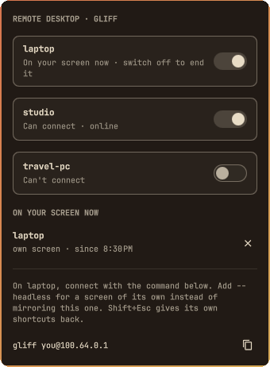

# Gliff Door for Omarchy

An [Omarchy](https://omarchy.org) bar widget that lets your other machines remote-desktop into this PC with [Gliff](https://github.com/omacom/gliff), each behind its own on/off switch. A machine's SSH key only works while its switch is on, only from its [Tailscale](https://tailscale.com) address, and only to start Gliff: it never gets a shell.



## What it does

- **Bar:** an icon that's dim while nobody may connect, in the accent colour while a machine is let in, and red with an eye while someone is on your screen. Middle-click flips the first machine's switch.
- **Panel** (left click): a switch per machine, who's on your screen right now (mirroring it, or with a screen of its own) with a button to end each session, and the command to connect from the other side.
- **Notifications** when a machine connects, and when one is refused.
- A warning if the SSH server is off or Gliff isn't installed.
- Every connection and refusal is logged in `~/.local/state/omarchy-gliff-door/door.log`.

Switching a machine off removes its key and ends its session within a second or two. The switch stays where you left it across reboots, because it *is* the key line in `~/.ssh/authorized_keys`.

## Setup

Both machines need Hyprland and Gliff. Omarchy installs Gliff on x86 machines; elsewhere, `omarchy pkg add gliff`. This PC also needs its SSH server with key logins, which `omarchy setup security sshd` sets up.

1. **Add the other machine** by name and its Tailscale device name (or IP):

   ```bash
   python3 ~/.config/omarchy/plugins/io.github.yassinesawahi.gliff-door/door.py add laptop my-laptop
   ```

2. **Send its public key here.** On the other machine (run `ssh-keygen -t ed25519` first if it has no key):

   ```bash
   omarchy tailscale send <this-pc> ~/.ssh/id_ed25519.pub
   ```

   It lands in `~/Downloads` (Omarchy receives Taildrop files there). Open the panel and press **Import as laptop's key**, or run `door.py key laptop ~/Downloads/id_ed25519.pub`.

3. **Switch it on** in the panel, or middle-click the icon.

4. **Connect** from the other machine:

   ```bash
   gliff you@<this-pc>             # mirror this PC's screen
   gliff --headless you@<this-pc>  # a screen of its own, sized to the window
   ```

   Shift+Esc gives the other machine its own shortcuts back. See [`examples/peers.json`](examples/peers.json) for what `door.py` keeps in `~/.config/omarchy-gliff-door/peers.json`.

## How it works

Gliff needs nothing but SSH: the client runs `ssh you@this-pc gliff-server --stdio` and streams the screen back through that connection. So who may open this PC with Gliff comes down to whose key `sshd` accepts, and what that key is allowed to run. The plugin manages exactly that.

- **The switch** is one line in `~/.ssh/authorized_keys`, written by `door.py` while the machine is let in and removed when it isn't:

  ```text
  restrict,from="100.64.0.2",command="/usr/bin/python3 -I …/door.py gate laptop" ssh-ed25519 AAAA… omarchy-gliff-door:laptop
  ```

  `restrict` takes away the shell's extras: no terminal, no port, agent or X11 forwarding, no `~/.ssh/rc`. `from=` makes sshd accept the key only from that machine's Tailscale address. `command=` makes every login with the key run the gate, whatever the client asked for. Other lines in the file are left exactly as they were.

- **The gate** (`door.py gate`) reads what the client asked to run. It accepts `gliff-server --stdio` with the options a Gliff client sends (`--headless`, `--output`, `--low-bandwidth`, `--full-chroma`, `--bitrate`, `--video`, `--capture`) and replaces itself with `/usr/bin/gliff-server`. Anything else is refused and logged: a shell, a second command, or `gliff-server --listen` (an unauthenticated TCP server). The client's command is parsed but never run through a shell.

- **The widget** runs `door.py status` on a timer and when Hyprland reports a screen capture starting, the same cue as Omarchy's built-in remote-session indicator. It finds sessions by looking for `gliff-server` processes; the gate tags each with the machine's name.

- **Keys** are checked before they're saved: exactly one public key, nothing in front of it. It can't be this PC's own key, or a key that already has full SSH access here (a switch couldn't keep that one out).

```text
 OTHER MACHINE                                   THIS PC
 gliff ------ ssh over Tailscale, port 22 ----> sshd
                                                 | key accepted only while the switch
                                                 | is on, and only from that machine
                                                 v
                                               door.py gate --> gliff-server --stdio
                                                 (refuses anything else)    |
                                                                            v
 window showing <------------ video, input, clipboard over ssh ---- Hyprland session

 bar widget --> door.py allow laptop on|off   (writes or removes the key line,
                                               ends running sessions on off)
```

Nothing opens on your router or to the internet. Tailscale carries the connection, and your tailnet policy still decides which devices can reach port 22 at all.

## Install

```bash
omarchy plugin add https://github.com/YassineSawahi/omarchy-gliff-door.git --enable
```

Needs `openssh` (sshd running, with key logins), `gliff`, `tailscale`, `python3` and `wl-clipboard`.

## Controls

| Action | Does |
|---|---|
| Left click | Open or close the panel |
| Middle click | Let the first machine in, or shut it out |
| Right click | Read the state again |
| `omarchy-shell io.github.yassinesawahi.gliff-door togglePeer <name>` | Flip a machine's switch (also `allow <name>`, `deny <name>`, `toggle`, `refresh`, `close`) |

The helper works on its own too:

```text
door.py add <name> <tailscale-name|ip>     add a machine (its switch starts off)
door.py key <name> <file|key|-|--downloads>
door.py allow <name> on|off|toggle
door.py kick <pid|name>                    end a running session
door.py remove <name>                      switch off and forget the machine
```

Ending a session with the panel's button while the switch is on lets Gliff reconnect on its own; switch the machine off to keep it out.

## Tests

```bash
python3 -m unittest discover -s tests
```

They run against a throwaway home folder, with a stand-in for `gliff-server`, so your real `authorized_keys` is never touched.

## Remove

```bash
python3 ~/.config/omarchy/plugins/io.github.yassinesawahi.gliff-door/door.py remove laptop   # for each machine
omarchy plugin remove io.github.yassinesawahi.gliff-door
```

`door.py remove` takes the machine's key line out of `~/.ssh/authorized_keys`. If you remove the plugin first, a key line left behind still points at the gate, which is gone, so logins with that key fail; delete lines ending in `omarchy-gliff-door:<name>` to tidy up. `~/.config/omarchy-gliff-door/` and `~/.local/state/omarchy-gliff-door/` can go too.

## License

MIT
